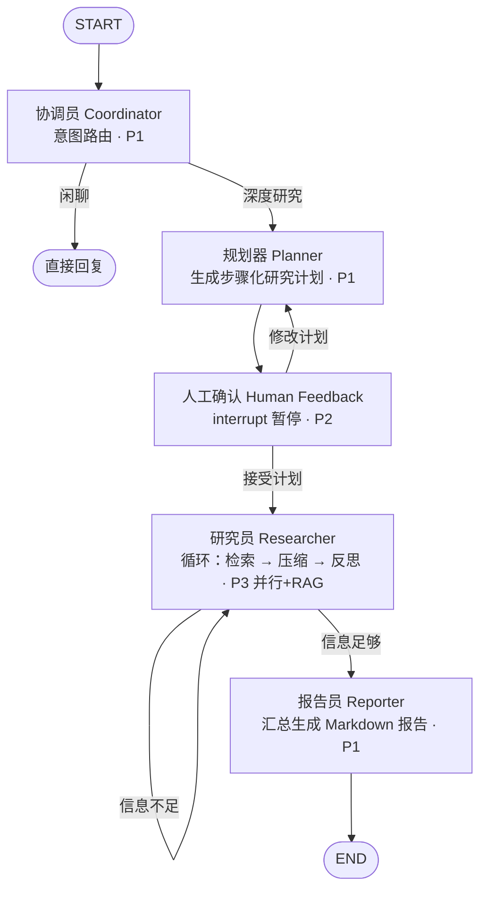

# DeepResearch AI 服务路线图

> 参考原型：[spring-ai-alibaba-deepresearch](https://github.com/alibaba/spring-ai-alibaba/tree/main/spring-ai-alibaba-examples/deepresearch)（Java）。
> 推进原则：**先 CLI 跑通闭环 → 再服务化 → 再加能力 → 最后生产化**。
> 每阶段结束都是可运行、可演示的状态；完成即打 tag，并对照 Java 原版写实现笔记（记录设计差异，沉淀学习素材）。

## 目标图编排

- 实线主路径：协调 → 规划 → 确认 → 研究 → 报告
- 虚线分支：闲聊直接回复 / 修改计划回退 / 信息不足继续检索
- 研究员是复杂度核心：P1 先串行循环，P3 再并行化 + 接 RAG

## 阶段计划

### P1 最小图闭环 → `v0.1.0`

- [ ] 依赖引入：`langgraph`、`langchain-core`、`openai`
- [ ] `core/config.py` 扩展：LLM 配置（`LLM_BASE_URL` / `LLM_API_KEY` / `LLM_MODEL`，预留按节点覆盖）
- [ ] `core/llm.py`：ChatOpenAI 工厂（OpenAI 兼容 base_url，DeepSeek / Qwen / OpenAI 通吃）
- [ ] `graph/state.py`：`ResearchState`（TypedDict + Annotated reducer）
- [ ] `graph/nodes/`：coordinator / planner / researcher / reporter 节点函数
- [ ] planner 结构化输出：Pydantic `ResearchPlan`（`with_structured_output`）
- [ ] `graph/build.py`：StateGraph 组装 + 条件边（coordinator 分支、researcher 循环）
- [ ] `prompts/`：各节点 prompt 模板独立文件
- [ ] CLI 入口：`uv run deepresearch "研究问题"` 输出 Markdown 报告
- [ ] 测试：节点单测（mock LLM）+ 图整体集成测试（fake LLM）

学习点：StateGraph / 条件边 / reducer 模型（对照 Spring 状态机思维）；Pydantic V2 结构化输出。
产出标准：CLI 端到端出报告，打 tag `v0.1.0`。

### P2 服务化 + 人机协同 → `v0.2.0`

- [ ] `POST /api/v1/research`：SSE 流式（`StreamingResponse` + async generator）
- [ ] SSE 事件协议：`node_start` / `token` / `node_end` / `interrupt` / `done`
- [ ] planner 后 `interrupt()`：计划生成即暂停
- [ ] `POST /api/v1/research/{id}/feedback`：恢复执行（接受 / 修改后继续）
- [ ] checkpointer：`MemorySaver` 起步，封装工厂便于 P4 换 Postgres

学习点：async generator / yield；SSE 协议；LangGraph interrupt + checkpoint 状态恢复。
产出标准：curl 能看到流式进度，能在计划处暂停并恢复。

### P3 并行研究 + RAG → `v0.3.0`

- [ ] Researcher 并行执行计划步骤：`asyncio.gather` 或 LangGraph Send API（map-reduce）
- [ ] SQLAlchemy 2.0 async + pgvector：知识库表、向量列、相似度检索
- [ ] `POST /api/v1/ingest`：文档切分、嵌入、入库（admin 上传后调用）
- [ ] 检索融合：web 搜索 + 本地向量库多路召回

学习点：Send API / asyncio.gather；pgvector；SQLAlchemy 2.0 async session 规范。
产出标准：上传的知识库文档可被研究引用；多步骤并行执行有可测加速。

### P4 生产化 + admin 集成 → `v1.0.0`

- [ ] JWT 校验：与 admin 共享 HS512 密钥，打通登录态（三集成点中最难，放最后）
- [ ] `PostgresSaver` 持久化 checkpoint
- [ ] 质检回环：Reporter 前加 reflection 节点，报告不达标回 Researcher 补研
- [ ] 可观测：OpenTelemetry / Langfuse trace
- [ ] docker compose 全容器化验证
- [ ] admin 侧：任务管理 + 报告展示页面（调 ai API）

学习点：生产级鉴权、可观测性、容器化交付。

## 技术决策记录

| 决策点 | 结论 | 理由 |
|---|---|---|
| LLM 接入 | OpenAI 兼容接口，`base_url` / `model` 全部可配 | DeepSeek / Qwen / OpenAI 通吃，换模型零成本（2026-10 定） |
| State 定义 | TypedDict + Annotated reducer | LangGraph 社区惯例，比纯 Pydantic state 少踩坑 |
| 结构化输出 | Pydantic + `with_structured_output` | planner / reflect 场景标准做法，顺带练 Pydantic V2 |
| Prompt 管理 | `prompts/` 独立文件，代码只做加载渲染 | 便于对照 Java 原版调优 |
| 测试策略 | 节点单测 mock LLM + fake LLM 图集成测试 | 图的 bug 多在边不在节点 |
| 依赖引入 | 按 P1-P4 分阶段加 | 骨架期不背重依赖树（见 pyproject.toml 注释） |

## 与 admin 的集成点（P2 后陆续接通）

1. **JWT 共享**：admin 登录签发（HS512），ai 用同一密钥校验 → P4
2. **数据分治**：admin 用 MySQL，ai 用 Postgres（pgvector），Redis 共享实例、db 号隔离（admin=0，ai=1）→ 已定
3. **任务/文件 API**：admin 上传知识库文件调 ai 的 ingest；研究任务由 ai 写库、admin 展示 → P3 起
